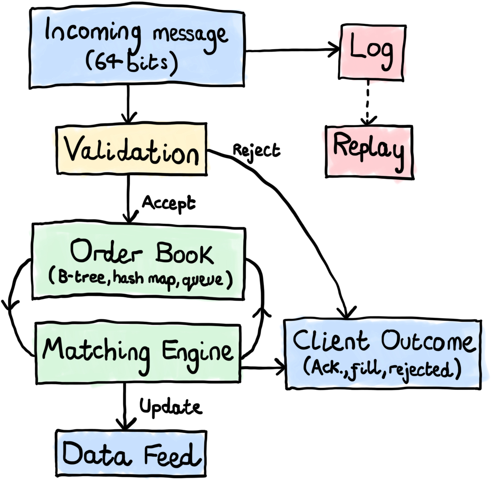
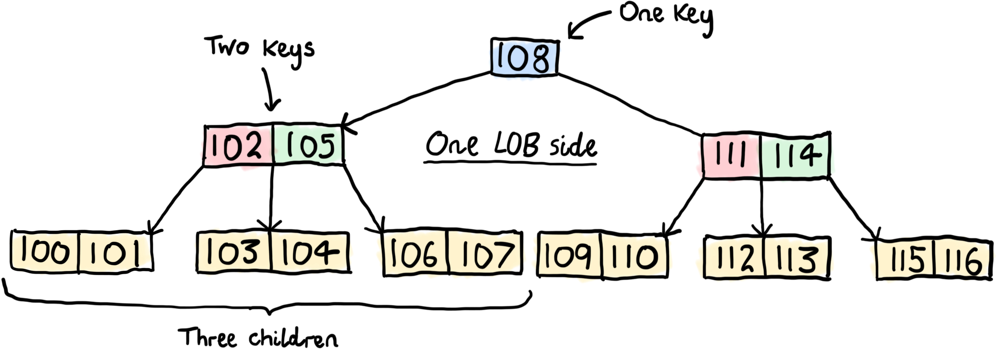
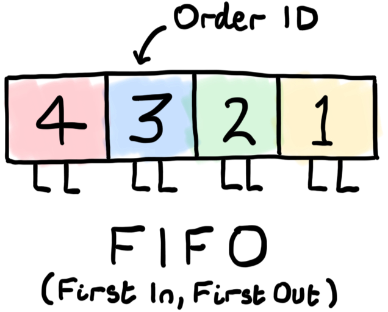
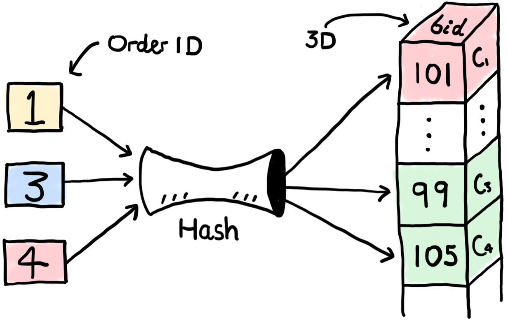
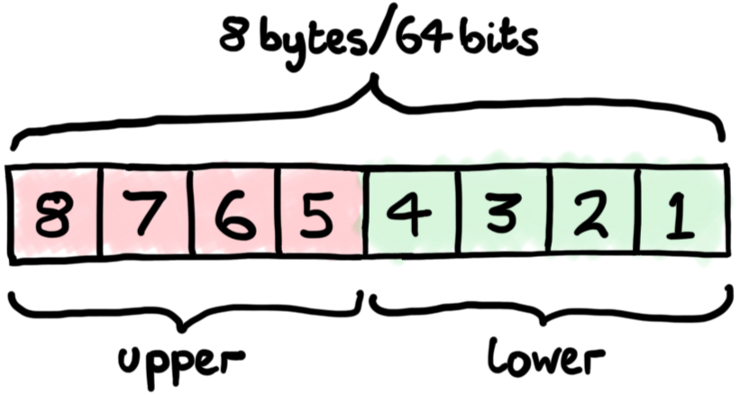

# microECN

Electronic communication networks (ECNs) are often large, complex systems. I wanted to strip an ECN back to its essentials and make it small enough that every moving part could be understood at a glance. The result is **microECN**: a compact, dependency-free Rust library. Rather than an exhaustive production system, microECN is an art project. Its purpose is not completeness, but clarity. It is an exploration of simplicity: a deliberately minimal system (only 190 lines in `lib.rs`!) that people can take apart, inspect, and truly understand from the inside out. Of course, a real-world ECN requires additional features and optimizations, and the gateway layer is intentionally outside the scope of this project. But as an educational tool, I hope microECN helps demystify how ECNs work while also providing a practical introduction to Rust. And, if I'm honest, I think there's something beautiful about reducing a complicated system to its irreducible core. With that in mind, let's walk through the project.

## What is an ECN?

An ECN is an electronic marketplace where participants buy and sell securities. Broadly speaking, there are two ways to do that: by posting a passive limit order or submitting an aggressive market order. A limit order is an offer to buy or sell a specified quantity at a specified price. A market order consumes those resting offers. Real-world ECNs typically support a small zoo of specialized order types. microECN does not. It implements just two. The first is a limit order with a fixed price and size that rests in the book until it is either matched or canceled. The second is an immediate-or-cancel (IOC) market order, which attempts to trade a specified quantity at the best available prices and automatically cancels any unfilled remainder. To support this, the ECN maintains an internal representation of the limit order book. A matching engine processes incoming orders, generates executions where possible, and publishes updates to a market data feed, which is typically anonymized.

<p align="center">
  
</p>

There are many ways to design an ECN, and reasonable people can disagree about which choices are best. Personally, I think a good ECN should follow what I call the **STAND** principle. Yes, I made the acronym up, but that has never stopped anyone in finance before. STAND stands for **Strict Total ordering**, **Auditable**, **Neutral**, and **Deterministic**. Strict total ordering means that every order can be placed into a single, unambiguous sequence. No ties, no uncertainty, and no arguments about who got there first. The most common implementation, and the one used by microECN, is *price-time priority*: better prices are matched first, and where prices are equal, earlier orders take priority. Auditability means anyone should be able to determine exactly what happened and why. microECN achieves this by being open source and producing a complete event log. Neutrality means the matching engine should not favor one participant over another. Identical orders should receive identical treatment. Finally, determinism means that the same sequence of orders will always produce the same outcome. No randomness, no hidden state, and no surprises. Whether STAND is the definitive framework for ECN design is debatable. Whether it is a convenient acronym invented by the author is not. In any case, microECN adheres to the STAND principle.

## Data structures

Before we get into matching logic, let's look at the three data structures that make up the limit order book. If you've ever wondered how an exchange answers questions like *"what's the best bid?"*, *"who gets filled first at $100?"*, and *"where did order 42 go?"*, these structures are doing almost all of the work.

```rust
pub struct Book {
    counter: u32,
    orders: HashMap<u32, (bool, i32, u32)>,
    sides: [BTreeMap<i32, VecDeque<(u32, i32)>>; 2],
}
```

The types tell most of the story:
- `counter` is the next order ID to assign.
- `orders` maps order IDs to tuples of side, price, and client ID.
- `sides` contains two B-trees: one for bids and one for asks.

An example of one side's B-tree is shown below. The *keys* are prices and the *values* are queues of order ID and size. B-trees are self-balancing search trees that keep prices sorted while supporting efficient inserts, deletes, and lookups in $O(\log n)$ time. For an order book, that means we can quickly find the best bid, best ask, or any specific price level without scanning the entire book.

<p align="center">
  
</p>

For each price level, there is a FIFO (first-in, first-out) queue of orders. New orders join the back of the queue, while matching occurs from the front. This directly implements *price-time priority*: if two orders have the same price, the one that arrived first gets filled first.

<p align="center">
  
</p>

Finally, the `orders` hash map answers the question: *"where is order 42?"*. Given an order ID, it identifies the side and price level containing the order, with average-case $O(1)$ lookup time. Without it, cancellations would require searching the orders in the book. There is, however, a small trade-off hiding here. The hash map tells us which queue to look in, but not where inside that queue the order sits. If there are $n$ orders resting at that price, finding the order within the queue is still $O(n)$. More sophisticated order books can achieve $O(1)$ cancellations by maintaining additional pointers, but at the cost of significantly more complexity. For microECN, I chose the opposite trade-off: slightly slower cancels in exchange for data structures that remain small enough to understand at a glance.

<p align="center">
  
</p>

## Message protocol

The message protocol is deliberately tiny. To submit an order, a client sends exactly **64 bits**. Not 64 bytes, not a JSON document, just 64 bits. The layout is simple: the lower 32 bits contain a signed order size, while the upper 32 bits contain the price. A positive size represents a buy order and a negative size represents a sell order. The interesting twist is that a size of zero is repurposed as a cancellation message. Rather than introducing a separate message type, microECN interprets the upper 32 bits as the ID of the order to cancel. Order entry and cancellation therefore share the same 64-bit format, with cancellations accepted only from the client that owns the order; attempts to cancel an unknown order or another client's order are rejected and leave the book unchanged. Market orders follow the same philosophy. A reserved price value, i32::MIN, is used to indicate a market order. Instead of introducing a separate order type and execution path, microECN treats a market order as an aggressively priced limit order. The reserved value is translated into a price that crosses the opposite side of the book, the normal matching algorithm runs, and any remaining quantity is canceled. As a result, limit orders, market orders, and cancellations all fit inside the same 64-bit message. The matching engine only needs to understand a single execution path, with specialized behavior emerging from a few carefully chosen conventions rather than additional protocol complexity.

<p align="center">
  
</p>

## Matching engine

The matching engine is beautifully simple. The algorithm is just: look at the best bid and best ask. If they overlap, execute a trade. Then do it again. Keep going until the prices no longer cross or one side runs out of quantity. That's the entire matching engine. Each pass consumes at least one resting order or finishes the incoming quantity, so the loop always makes progress. There is no hidden optimization, auction theory, or mysterious exchange magic lurking underneath. A matching engine is mostly just a machine for repeatedly asking *"can these two orders trade?"* and then continuing until the answer becomes *"no"*. When two orders do meet, the older order sets the execution price. Since order IDs are assigned in arrival order, determining the maker side is simple:

```rust
let maker = bid_id < ask_id;
let price = if maker { bid } else { ask };
```

That's it. The lower ID belongs to the older order, the older order is the maker, and the maker's price becomes the execution price. One nice consequence of this design is that no separate timestamps or per-level priority structures are required. The FIFO queues already encode time priority, while the monotonically increasing order IDs tell us which order arrived first when generating the trade report. In other words, the matching engine gets away with remarkably little bookkeeping. The queues remember who was first in line, the IDs remember who was older, and the matching loop just keeps asking whether the bid and ask still want to do business with each other.

## Market data feed

The market data feed is the ECN's public-facing version of events. It tells everyone what happened, but not who made it happen. Orders arrive, trades execute, liquidity appears and disappears, and the feed reports the results without revealing the identities behind them. Each update contains a timestamp, a sequence number, and a data item describing either a trade or the aggregate quantity available at a particular price level. When a trade occurs, the feed publishes the execution along with the updated sizes of the affected bid and ask levels. When an order is added or canceled, the feed simply publishes the new aggregate size at the affected price level. The sequence number exists because clocks are imperfect storytellers. Multiple updates can share the same timestamp, particularly in a busy market, so updates are numbered as they are published. This gives every event an unambiguous place in the feed, even when several things happen at effectively the same instant. There is one further bit of housekeeping. Internally, market orders are matched using sentinel prices that exist purely to drive the matching logic. These prices are implementation details, not real market levels, so they are filtered out before publication. The result is a feed that contains only information that would make sense to an actual market participant: trades and meaningful changes to the visible order book.

## Replays

Before microECN processes a message, it records the message in a write-ahead log together with its timestamp and client ID:

```rust
append(w, ts, c, msg).map(|_| lob.handle(feed, ts, c, msg))
```

This is the engine's version of "write it down before you do anything". Each log record contains fixed-width, little-endian fields: a 16-byte timestamp, a 4-byte client ID, and an 8-byte message, for a total size of 28 bytes. After appending the record, `receive` calls `sync_all` before making any changes to the in-memory book. If either the write or sync fails, the error is returned and the message is not applied. Replay uses the same matching logic as live operation. There is no separate reconstruction path. During recovery, each recorded message is loaded and passed through the same handler in the same order in which it was originally processed. Given a complete log whose writes were successfully persisted, this deterministically reconstructs the order book, execution reports, and market data feed by replaying the recorded history one message at a time.
